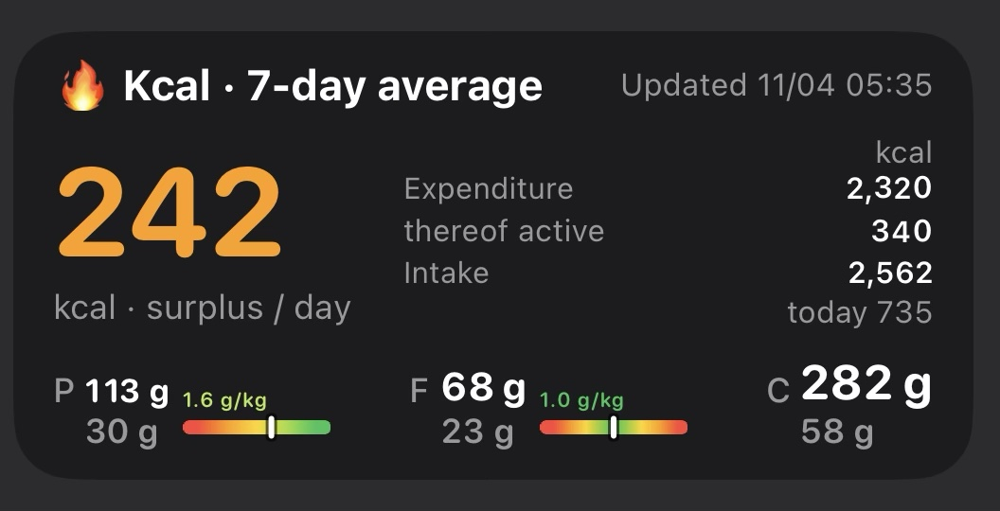

# Kcal Deficit Widget for iOS (Scriptable + Shortcuts)

A home screen widget that shows **7-day averages** from Apple Health:
calorie expenditure, calorie intake, deficit or surplus, and macronutrients
with a color-coded rating for the goal *lose fat, build muscle*.
Optionally it also shows **today's totals** (intake and macros) in gray.

<p align="center">
  
  <br>
  <sub>Medium widget with the German interface (<code>LANGUAGE = "de"</code>)</sub>
</p>

Scriptable cannot access Apple Health. So an **Apple Shortcut** reads the data
and saves it as `kcal.json`, and the **Scriptable script** reads that file and draws the widget.

```
Apple Health ──▶ Shortcut ──▶ iCloud Drive/Scriptable/kcal.json ──▶ Scriptable widget
```

## What the widget shows

- **Average deficit or surplus per day** (expenditure − intake): green for a deficit, orange for a surplus
- **Expenditure** (resting + active energy), thereof active, and **intake**
- **Macros**: protein (P), fat (F) and carbs (C) in grams, each with a rating
- **Today** (optional): today's intake below the average intake, and today's grams below each macro, in gray and without a rating (a day in progress would almost always look "too low"). After midnight they show 0 until the shortcut runs again.
- **Updated**: time of the last update (orange if older than 26 hours)

The small widget shows only the deficit or surplus. The large widget adds target ranges for protein and fat.
Supported sizes: small, medium, large, plus lock screen (rectangular and inline).
The interface is available in English and German (`LANGUAGE` setting).

## Macro rating

| Color | Protein (g per kg body weight) | Fat (% of calories eaten) |
|---|---|---|
| dark green | ≥ 2.0 | 20–30 % |
| light green | 1.6–2.0 | 30–35 % |
| yellow | 1.2–1.6 | 35–40 % |
| orange | 0.8–1.2 | 15–20 % or 40–45 % |
| red | < 0.8 | < 15 % or ≥ 45 % |

Carbs are shown as a share of calories in gray. They fill the remaining calories and have no fixed target.

Background:
- Protein: above roughly 1.6 g/kg, more protein adds little extra muscle gain during resistance training ([Morton et al. 2018](https://pubmed.ncbi.nlm.nih.gov/28698222/)). In a calorie deficit, higher amounts can help preserve muscle ([ISSN Position Stand 2017](https://www.ncbi.nlm.nih.gov/pmc/articles/PMC5477153/)). So there is no penalty at the top end.
- Fat: the reference range is 20–35 % of energy ([AMDR](https://pressbooks.umn.edu/sleepeatandexercise/?p=279)). The lower part is preferred, leaving more calories for protein and carbs.

The widget only gives guidance and is not a substitute for professional nutrition advice.

## Setup

### 1. The shortcut "Kcal Deficit"

https://www.icloud.com/shortcuts/0f9098fc2b584019b69dd829c344f55a

This shortcut queries Apple Health, calculates the 7-day averages and saves them as `kcal.json`.
It needs no AI and runs in a few seconds.

**a) Fixed day boundaries**

These make the values match the weekly averages in the Health app. The current, unfinished day is left out on purpose, because a half day would lower every average.

| # | Action | Setting | Name the result |
|---|---|---|---|
| 1 | `Current Date` | – | |
| 2 | `Format Date` | Date Format: *Custom*, `yyyy-MM-dd` | |
| 3 | `Get Dates from Input` | input: formatted date → today at 00:00 | **End** |
| 4 | `Adjust Date` | *Subtract* 7 *days* from **End** | **Start** |

**b) One Health query per value**

Add a `Find Health Samples` action for each of these types:

| Type | Unit | Average used for |
|---|---|---|
| Resting Energy | kcal | `Expenditure` |
| Active Energy | kcal | `Expenditure`, `Active` |
| Dietary Energy | kcal | `Intake` |
| Protein | g | `Protein` |
| Total Fat | g | `Fat` |
| Carbohydrates | g | `Carbs` |

Use the same settings in every query:
- Filter: **Start Date is between** *Start* and *End*
- Group By: **Day**
- **Fill Missing: off**. Otherwise days without entries count as 0. That matters most for intake: a day you did not log would make your deficit look bigger than it is.
- Sort By: *None*, Limit: *off*

After each query:
1. `Calculate Statistics`: **Average** of the samples
2. `Round Number`: to a whole number

Then calculate the expenditure with `Calculate`: average resting energy **+** average active energy.

**c) Weight**

`Find Health Samples` with type *Weight*, Sort By *Start Date*, Order *Latest First*, Limit *1*.
If you do not track your weight in Health, skip this and set `WEIGHT_KG` in the script instead.

**d) Today's totals (optional)**

Add a `Find Health Samples` action for *Dietary Energy*, *Protein*, *Total Fat* and *Carbohydrates* with the filter **Start Date is today** and **no grouping**.
After each query: `Calculate Statistics` → **Sum**, then `Round Number`.
If you skip this, the widget simply shows no today values.

**e) Save the result**

1. A **Dictionary** with these keys (values as numbers):

   | Key | Content |
   |---|---|
   | `Expenditure` | average resting + active energy (kcal) |
   | `Active` | average active energy (kcal) |
   | `Intake` | average dietary energy (kcal) |
   | `Protein` | average protein (g) |
   | `Fat` | average fat (g) |
   | `Carbs` | average carbohydrates (g) |
   | `Weight` | current weight (kg) |
   | `TodayIntake` | optional: today's dietary energy (kcal) |
   | `TodayProtein`, `TodayFat`, `TodayCarbs` | optional: today's macros (g) |

   The German keys `Bedarf`, `Aktiv`, `Aufnahme`, `Fett`, `Kohlenhydrate`, `Gewicht`, `HeuteAufnahme`, `HeuteProtein`, `HeuteFett` and `HeuteKohlenhydrate` work as well.
2. **Save File**: destination *iCloud Drive/Scriptable*, subpath `kcal.json`, "Ask Where to Save" off, **Overwrite** on.

**Using more than one device (e.g. iPad):** Shortcuts sync via iCloud, but Health data on an iPad can lag behind or be incomplete. If the shortcut runs there, it overwrites `kcal.json` with wrong values. To prevent this, wrap the *Save File* step in `Get Device Details` (*Device Model*) → `If` *Device Model* *is* *iPhone*. The widget itself works on every device, because it only reads the file.

Example of a resulting `kcal.json`:

```json
{
  "Expenditure": 1828,
  "Active": 323,
  "Intake": 1221,
  "Protein": 58,
  "Fat": 52,
  "Carbs": 126,
  "Weight": 80,
  "TodayIntake": 640,
  "TodayProtein": 35,
  "TodayFat": 22,
  "TodayCarbs": 70
}
```

### 2. The script in Scriptable

1. Create a new script in Scriptable and paste the content of [`Kcal-Widget.js`](Kcal-Widget.js).
2. Set `LANGUAGE` to `"en"` or `"de"`.
3. Add a Scriptable widget to your home screen, choose the script and set "When Interacting" to **"Open App"**.

### 3. Updating

- **Automatically**: run the shortcut at the end of the shortcut you use to log meals (see [Logging meals with AI](#optional-logging-meals-with-ai-nutrition-tracking-shortcut)) (action *Run Shortcut*, "Show When Run" off). An automation with the trigger "App is opened" also works. Health data cannot be read while the iPhone is locked, so automations based only on time of day are unreliable.
- **Tapping the widget** opens Scriptable and loads the latest `kcal.json` from iCloud. It does not run the shortcut – the averages only cover completed days and today's totals only change when you log food, which already runs the shortcut.
- The widget asks iOS for an update every 15 minutes. When it is actually redrawn is up to iOS (often less frequently on an iPad). On other devices, the widget also depends on how quickly iCloud Drive syncs the file.

Because only completed days are counted, the averages change once a day (the first time the shortcut runs after midnight), or when you add entries for a past day.

## Optional: logging meals with AI ("Nutrition Tracking" shortcut)

https://www.icloud.com/shortcuts/f81df3171f2c4cdea531167ceca31fb6
This is the shortcut I use to log meals. You describe a meal in a few words or take a photo of it,
an AI model estimates calories and macros, and the shortcut saves them to Apple Health.
At the end it runs "Kcal Deficit", so the widget data stays up to date.
Any other way of logging food to Apple Health (for example a food tracking app) works with the widget as well.

| # | Action | Setting |
|---|---|---|
| 1 | `Choose from Menu` | prompt: *"What did you eat?"*, options **Text** and **Photo** |
| 2 | ↳ **Text**: `Ask for Input` | input type *Text*, prompt e.g. *"Describe your meal"* |
| 3 | ↳ **Photo**: `Take Photo` | 1 photo, back camera |
| 4 | `End Menu` | the result is either the text or the photo (*Menu Result*) |
| 5 | `Use Model` (Apple Intelligence) | a cloud model that can read images; prompt below, input: *Menu Result* |
| 6 | `Get Dictionary Value` ×4 | keys `calories`, `fat`, `carbs`, `protein` from the model's *Response* |
| 7 | `Log Health Sample` ×4 | *Dietary Energy* (kcal), *Total Fat* (g), *Carbohydrates* (g), *Protein* (g), each with the matching dictionary value; date left empty = now |
| 8 | `Show Result` | e.g. *"Logged: … kcal, fat … g, carbs … g, protein … g"* |
| 9 | `Run Shortcut` | **Kcal Deficit**, "Show When Run" off |

Prompt for step 5:

```text
Analyze this food input and return ONLY a JSON-formatted answer with the keys
'calories', 'fat', 'carbs' and 'protein'. The values must be plain numbers
(calories in kcal, macros in grams). Input: [Menu Result]
```

Tips:
- If the model wraps its answer in a code block or adds text, `Get Dictionary Value` fails. Some versions of `Use Model` let you choose *Dictionary* as the output type, which avoids this.
- AI estimates from a description or photo can be well off, especially for oil, sauces and portion sizes. Weighing food and using nutrition labels is more accurate.
- Remove step 8 if you do not want to confirm every entry.

## Settings in the script

| Constant | Default | Meaning |
|---|---|---|
| `LANGUAGE` | `"en"` | interface language: `"en"` or `"de"` |
| `FILE` | `kcal.json` | file name in iCloud Drive/Scriptable |
| `STALE_HOURS` | `26` | data older than this is marked orange |
| `REFRESH_MIN` | `15` | requested update interval in minutes |
| `WEIGHT_KG` | `null` | fallback weight if the shortcut does not provide one |
| `TARGET_WEIGHT_KG` | `null` | base protein on the target weight (useful with significant overweight) |
| `LEVELS_PROTEIN`, `LEVELS_FAT` | see above | limits of the color levels |

## Notes and limitations

- Calorie values are estimates. The Apple Watch can be noticeably off on expenditure, and food logs are rarely complete. The most reliable check is your weight trend over several weeks.
- The shortcut cannot detect partially logged days. They lower the average intake.
- If the watch was not worn for part of a day, resting energy for that day is too low as well.

## Disclaimer

This project is provided for personal use and information only. It is not medical or nutritional advice
and not a medical device. Talk to a doctor or registered dietitian before changing your diet,
especially if you have health conditions.

This is an independent project. It is not affiliated with or endorsed by Apple or the developer of Scriptable.
Apple Health, Shortcuts, iCloud and Apple Intelligence are trademarks of Apple Inc.

## License

[MIT](LICENSE) © 2026 Anton Angierski
