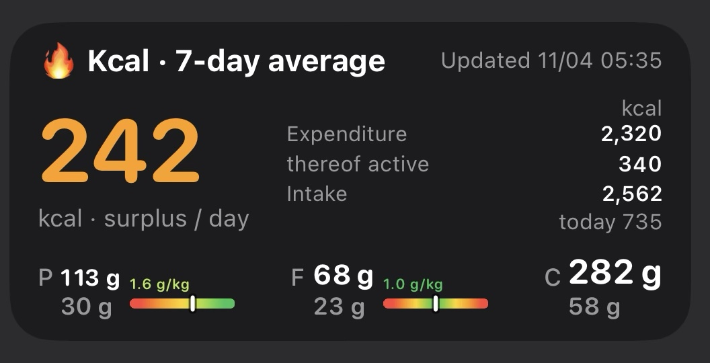

# 🔥 Kcal Deficit Widget

**See at a glance whether you are in a calorie deficit – right on your home screen, without opening an app.**

Log a meal in seconds: **describe it or snap a photo**, and Apple Intelligence estimates calories and macros and saves them to Apple Health. The widget updates right away.

<p align="center">
  
  <br>
  <sub>Medium widget (example values)</sub>
</p>

## What the widget shows

- **Calorie balance of the last 7 days:** eaten vs. burned, as an average deficit (green) or surplus (orange) per day
- **Macros:** protein, fat and carbs, with color scales for protein and fat (goal: *lose fat, build muscle*)
- **Today:** what you have eaten so far today, in gray

All data comes from **Apple Health**. No accounts, no extra app servers.

---

## Before you start

| You need | Why |
|---|---|
| An iPhone | Health data is read on the iPhone. |
| The free app **Scriptable** | It displays the widget. You do **not** need to know how to code. |
| Meals logged in Apple Health | Easiest with the included **Nutrition Tracking** shortcut (step 4). Without food data the widget has nothing to show. |
| For the AI meal logging: an iPhone with **Apple Intelligence** (iPhone 15 Pro or newer, iOS 26) | The shortcut uses Apple's built-in AI model. |
| Optional: your weight in Apple Health | Used to rate protein and fat per kg. You can also enter it in the script. |

> **Why two parts (shortcut + Scriptable)?**
> Only Apple Shortcuts can read your Health data. The shortcut fetches the numbers, Scriptable shows them as a widget.

---

## Installation (about 5 minutes)

### 1. Install Scriptable
[**→ Scriptable on the App Store (free)**](https://apps.apple.com/app/scriptable/id1405459188)
Open the app once afterwards, so its folder in iCloud Drive is created.

### 2. Add the script
Choose one of the two ways:

**a) Save the file** (no copying)
1. Open [**Kcal-Widget.js**](Kcal-Widget.js) on your iPhone and tap the **download** button.
2. Tap **Share** → **Save to Files** → **iCloud Drive › Scriptable** → **Save**.

**b) Copy and paste**
1. Open [**Kcal-Widget.js**](Kcal-Widget.js) on your iPhone, tap **Raw**, select all and copy.
2. In Scriptable, tap **+** at the top right, paste the text and name the script `Kcal-Widget`.

✅ **Kcal-Widget** now appears in Scriptable.
For a German widget, change `LANGUAGE = "en"` to `LANGUAGE = "de"` at the top of the script.

### 3. Add the "Kcal Deficit" shortcut
This shortcut reads Apple Health and hands the numbers to the widget.

1. Open [**Kcal Deficit.shortcut**](shortcuts/Kcal%20Deficit.shortcut) and tap the **download** button (or **View raw**).
2. Open the downloaded file (Safari downloads or the Files app) and tap **Add Shortcut**. Keep the name **Kcal Deficit**.
3. Open the shortcut and check the last action **Save File**: the folder must be **iCloud Drive › Scriptable**. If not, tap it and choose that folder.
4. **Run it once by hand** and tap **Allow** when it asks for access to Health and the Scriptable folder.

### 4. Log your meals ⭐
[**→ "Nutrition Tracking" shortcut**](shortcuts/Nutrition%20Tracking.shortcut) – install it the same way as step 3.

**How it works:** run the shortcut → choose **Text**, **Photo** or **Text + Photo** → check the estimate → tap **Yes**.
Calories and macros go to Apple Health, and **Kcal Deficit** runs automatically, so the widget is always up to date.

On the first run, allow access to the camera, Apple Intelligence and Health.
If the last action **Run Shortcut** is empty, tap it and choose **Kcal Deficit**.

> 💡 **Tip:** Add "Nutrition Tracking" to your home screen or to the Action Button – then logging a meal takes about 10 seconds.

<details>
<summary>Alternative: you already use a food tracking app (e.g. Yazio, MyFitnessPal, Lose It)</summary>

That works too, as long as the app writes to Apple Health (check: **Health app → your profile → Apps → your food app → turn on Dietary Energy, Protein, Total Fat and Carbohydrates**).

Because your app does not run Kcal Deficit, let an automation do it:
1. Open Shortcuts → **Automation** → **+** → **App**.
2. Choose your food app, select **Is Closed** and **Run Immediately**.
3. Choose the shortcut **Kcal Deficit** as the action.

Do not use a time-of-day automation: Health data cannot be read while the iPhone is locked, so it often fails.
</details>

### 5. Place the widget
1. Long-press an empty spot on the home screen → **Edit** → **Add Widget**.
2. Search for **Scriptable** and choose the **medium** size (small, large and lock screen widgets work too).
3. Long-press the new widget → **Edit Widget**:
   - **Script:** `Kcal-Widget`
   - **When Interacting:** `Open App`

🎉 **Done!** From now on the widget updates every time you log a meal.

---

## Adjust it to you

Open the script **Kcal-Widget** in Scriptable. At the very top are the settings. These are the only lines you might want to change:

```javascript
const LANGUAGE = "en";            // "en" or "de"
const WEIGHT_KG = null;           // your weight, e.g. 80 – only if it is not in Apple Health
const TARGET_WEIGHT_KG = null;    // optional: rate protein and fat based on your target weight
```

The color levels for protein and fat can be changed as well – see [docs/TECHNICAL.md](docs/TECHNICAL.md#macro-rating).

---

## Problems?

| What you see | Solution |
|---|---|
| "kcal.json is missing – run the shortcut once." | Run **Kcal Deficit** by hand (step 3) and check that **Save File** points to the Scriptable folder. |
| "No weight – …" | Add your weight in Apple Health or set `WEIGHT_KG` in the script. |
| Intake or macros show 0 or "–" | Apple Health has no food data for the last 7 days. If you use a food app, check that it may write to Health. |
| "Updated" time is orange | The data is older than 26 hours. Log a meal or run **Kcal Deficit**. |
| Today's values show 0 after midnight | Normal – they reset until the shortcut runs again on the new day. |
| The widget does not refresh | iOS decides when widgets are redrawn. Tap the widget to load the latest data. |
| Something else | [Open an issue](../../issues) and describe what you see (a screenshot helps). |

---

## Privacy

There are no servers and no tracking in this project. The numbers are stored in a small file (`kcal.json`) in your iCloud Drive.
The AI meal estimate runs through Apple Intelligence – on the device or on Apple's Private Cloud Compute.

## Important note

The widget shows estimates. Calorie burn measured by the Apple Watch and AI estimates of meals can be noticeably off – the most reliable check is your weight trend over several weeks.
This project is **not medical or nutritional advice** and not a medical device. Talk to a doctor or registered dietitian before changing your diet, especially if you have health conditions.

This is an independent project, not affiliated with or endorsed by Apple or the developer of Scriptable. Apple Health, Shortcuts, iCloud and Apple Intelligence are trademarks of Apple Inc.

---

**For developers:** how the shortcuts and the script work together, the exact calculation, the macro rating with sources and how to build the shortcuts from source: [**docs/TECHNICAL.md**](docs/TECHNICAL.md)

**License:** [MIT](LICENSE) © 2026 Anton Angierski
